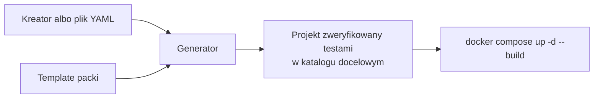
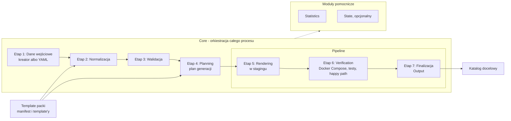

# SDI - Duża Prezentacja

Numeracja slajdów jest taka sama jak w DP_prez.md.

## Wstęp

### Slajd 1: Tytuł (0:15)

Generator szkieletów aplikacji webowych

Rafał Mironko, Informatyka, Inżynieria Oprogramowania

Opiekun: dr Szymon Kijas, IAiIS

### Slajd 2: Plan prezentacji (0:30)

- Problem i istniejące rozwiązania
- Cel pracy i oczekiwane działanie
- Specyfikacja i architektura
- Kluczowe decyzje i ryzyka
- Dotychczasowe wyniki i plan prac

## Problem i istniejące rozwiązania

### Slajd 3: Omówienie problemu (2:00)

Wielu programistów doskonale potrafi rozszerzać i edytować aplikacje webowe. Gorzej, kiedy trzeba postawić nową. Sam wiele razy musiałem stawiać nowy projekt i zawsze kończyło się to tak samo: albo pisałem niemal identyczny boilerplate'owy kod i wykonywałem niemal identyczne procedury, albo po prostu kopiowałem i okrajałem stary projekt. Oba podejścia mają wady. Pierwsze to duża strata czasu. Drugie zabiera mniej czasu, ale niesie ryzyko pomyłki, pozostawienia czegoś, co nie powinno znaleźć się w repo, oraz narzucenia sobie starej, nieaktualizowanej struktury.

Samo postawienie projektu od nowa zwykle wymaga sięgnięcia do dokumentacji, żeby:

- poprawnie zainicjalizować projekt frontendu
- napisać podstawowy routing
- zainstalować odpowiednie pakiety
- połączyć frontend z backendem bez problemów z CORS
- stworzyć Dockerfile, który od razu zadziała

Do tego dochodzą elementy, które ma prawie każda aplikacja:

- rejestracja i logowanie z obsługą tokenów JWT
- migracje bazy danych
- testy
- healthchecki

Problematyczne dla początkujących jest też pilnowanie od początku standardów i konwencji oraz pisanie aplikacji gotowej do uruchomienia i testowania w kontenerach Docker.

Wszystko to po prostu zabiera czas, nieważne, jak dobry programista by nie był. Dlatego postanowiłem stworzyć generator szkieletów aplikacji webowych, który wszystkie te nieprzyjemne, boilerplate'owe kroki wykona za użytkownika.

### Slajd 4: Przegląd podobnych rozwiązań (2:00)

| Rozwiązanie                                                               | Wybór frontend x backend | Auth, testy, Docker od razu | Weryfikacja projektu przed oddaniem                           | Aktualizacja z szablonu              | Główne ograniczenie                                                |
| ------------------------------------------------------------------------- | ------------------------ | --------------------------- | ------------------------------------------------------------- | ------------------------------------ | ------------------------------------------------------------------ |
| Własny stary projekt (kopiuj i okrój)                                     | nie                      | zależy                      | nie                                                           | nie                                  | ryzyko pomyłki, pozostałości w repo (np. sekrety), stara struktura |
| Kreatory frameworków (create-vite, create-nuxt, django-admin, dotnet new) | nie                      | nie / częściowo             | nie                                                           | nie                                  | tylko jedna część aplikacji                                        |
| Silniki szablonów (cookiecutter, Copier, Yeoman)                          | zależy od szablonu       | zależy od szablonu          | możliwa, ale trzeba ją zbudować w szablonie                   | Copier tak, cookiecutter przez cruft | jakość zależy od autora szablonu                                   |
| full-stack-fastapi-template                                               | nie                      | tak                         | nie (tylko CI szablonu)                                       | nie                                  | jeden, stały stack                                                 |
| JHipster                                                                  | tak                      | tak                         | nie (testy uruchamia użytkownik)                              | tak                                  | backend domyślnie Spring Boot, inne przez blueprinty               |
| Asystenci AI (LLM)                                                        | tak                      | zależy od promptu           | niegwarantowana                                               | nie                                  | wynik niedeterministyczny, wymaga przeglądu                        |
| Generator szkieletów aplikacji webowych                                   | tak\*                    | tak                         | tak, domyślnie (Docker Compose, testy, happy path w stagingu) | nie (świadomie)                      | mało stacków                                                       |

\* z założenia architektury. W programie minimum jest jedna kombinacja.

Weryfikacja konkretnego wygenerowanego projektu jest w moim generatorze wbudowana i domyślna, a projekt trafia do katalogu docelowego dopiero po sukcesie. W Copierze i cookiecutterze da się to zbudować samemu w szablonie.

## Cel pracy i oczekiwane działanie

### Slajd 5: Cel pracy i efekt dla użytkownika (1:00)

Celem projektu jest zaprojektowanie i implementacja narzędzia CLI generującego konteneryzowane szkielety aplikacji webowych na podstawie kreatora lub pliku konfiguracyjnego. Generator ma ograniczyć ilość powtarzalnej pracy potrzebnej do uruchomienia nowej aplikacji oraz zapewnić spójny, testowalny i rozszerzalny punkt startowy dla dalszego rozwoju projektu.

Po przejściu przez kreator aplikacji lub uruchomieniu generatora z plikiem konfiguracyjnym powstaje działający, konteneryzowany szkielet aplikacji webowej z konfiguracją środowiskową, który wystarczy rozszerzać i modyfikować.

Generator jest przeznaczony zarówno dla doświadczonych programistów, którzy chcą zaoszczędzić czas, jak i dla początkujących, którym pozwala zacząć od projektu zgodnego ze standardami i konwencjami. Projekt uznaję za poprawny dopiero wtedy, gdy przechodzi testy, a nie gdy powstały pliki.

### Slajd 6: Oczekiwane działanie (0:30)



Generator działa w dwóch trybach:

- kreator: użytkownik odpowiada na pytania o nazwę projektu, katalog docelowy, frontend, backend-db stack, porty i zmienne środowiskowe. Porty i zmienne mogą przyjąć wartości domyślne
- plik konfiguracyjny YAML: generator działa bez interakcji. Jeśli katalog docelowy nie jest pusty, przerywa działanie, chyba że uruchomiono go z flagą -f

Użytkownik wybiera:

- frontend: Nuxt, opcjonalnie React
- backend-db stack, czyli backend razem ze swoją bazą danych: FastAPI + SQLite oraz drugi stack z PostgreSQL (ASP.NET Core albo Django)

Każdą technologię dostarcza template pack, czyli paczka szablonów dla jednej technologii. Generator tworzy projekt, weryfikuje go testami i dopiero wtedy zapisuje w katalogu docelowym.

### Slajd 7: Przykład (0:30)

Przykładowy plik konfiguracyjny (bez sekcji ze zmiennymi środowiskowymi, bo brakujące sekrety generator losuje sam):

```yaml
version: 1

project:
  name: "moj_projekt"
  output_dir: 'C:\Projects'

frontend: "frontend_nuxt"

backend: "backend_fastapi_sqlite"

ports:
  frontend: Null
  backend: Null
  database: Null
```

Struktura wygenerowanego projektu:

```
|--/docs
|--/frontend
|--/backend
|--/database (opcjonalny)
|--.env (opcjonalny)
|--.env.example (opcjonalny)
|--README.md
|--docker-compose.yml
|--.gitignore
|--.dockerignore
```

Wygenerowany projekt uruchamia się jednym poleceniem: `docker compose up -d --build`.

## Specyfikacja i architektura

### Slajd 8: Wspierane technologie (1:00)

Pierwotna specyfikacja zakłada cztery kombinacje: Nuxt albo React z FastAPI + SQLite albo z Django + PostgreSQL. Generator w tej wersji nie musi obsługiwać kombinacji spoza tej listy, ale musi być rozszerzalny o nowe frameworki frontendowe i backendowe.

Planowane zmiany względem specyfikacji:

- React prawdopodobnie powstanie w wersji okrojonej, głównie o testy i obsługę błędów. Nadal będzie spełniał kontrakt API, więc zadziała z oboma backend-db stackami.
- Drugim backend-db stackiem może zostać ASP.NET Core + PostgreSQL zamiast Django + PostgreSQL. Backend spoza ekosystemu Pythona lepiej sprawdza, czy rozszerzanie generatora rzeczywiście nie zależy od technologii. Jeśli zabraknie czasu, zostaje Django + PostgreSQL, które korzysta z istniejącej infrastruktury dla Pythona.

Decyzję podejmę najpóźniej do końca listopada. Priorytetem jest zapas czasu na dokończenie generatora i napisanie pracy, nawet kosztem okrojonego Reacta i pozostania przy Django.

### Slajd 9: Wymagania funkcjonalne (1:00)

#### Wymagania funkcjonalne generatora

- utworzenie projektu na podstawie kreatora albo pliku konfiguracyjnego
- walidacja konfiguracji przed generacją: niewspierana kombinacja, brak wymaganych danych, niepoprawny katalog docelowy, konflikt portów, niepoprawne zmienne środowiskowe
- weryfikacja wygenerowanego projektu testami przed zapisem w katalogu docelowym
- raport czasu generacji i podstawowych statystyk
- opcjonalnie wznowienie generacji po błędzie. Zmiana względem specyfikacji: powstanie, jeśli wystarczy czasu

#### Wymagania wobec wygenerowanej aplikacji

- frontend: routing, strony logowania, rejestracji, aplikacji (dostępna po zalogowaniu) i 404, klient HTTP do backendu, obsługa tokena JWT i błędu logowania
- backend (kontrakt API): `GET /health`, `GET /health/db`, `GET /health/ready` bez prefiksu oraz `POST /api/v1/auth/register`, `POST /api/v1/auth/login`, `GET /api/v1/auth/me`. Requesty i odpowiedzi w JSON, obsługa CORS i JWT
- baza danych (kontrakt danych): PostgreSQL albo SQLite, migracje i minimalny model użytkownika, który pozwala na jednoznaczną identyfikację, rejestrację i logowanie emailem, weryfikację hasła zapisanego jako hash oraz oznaczenie konta jako aktywnego lub nieaktywnego
- testy: jednostkowe i integracyjne we frontendzie i backendzie

"Działanie" definiuję przejściem testów integracyjnych oraz testu dymnego happy path: rejestracja -> logowanie -> pobranie danych użytkownika.

### Slajd 10: Wymagania niefunkcjonalne i ograniczenia (1:00)

#### Wymagania niefunkcjonalne

- deterministyczność: ta sama konfiguracja daje ten sam wynik strukturalny, poza losowanymi sekretami
- rozszerzalność: dodanie nowego frontendu albo backendu nie wymaga modyfikacji istniejących kombinacji
- niezależność od generatora: wygenerowany projekt uruchamia się, testuje i rozwija bez generatora oraz nie importuje jego bibliotek
- jakość: SOLID, DRY, testy, czytelny kod z docstringami bez komentarzy linijkowych oraz dokumentacja standardów i sposobu rozszerzania, sprawdzane automatycznie narzędziami jakości i testami

#### Ograniczenia

- infrastruktura: brak Kubernetes, TLS, Nginx i reverse proxy, load balancingu, CI/CD oraz osobnych kontenerów dev i prod
- funkcjonalność: brak SSO, resetu hasła i wysyłki emaili

### Slajd 11: Najważniejsze części (1:30)

- Core: główny moduł sterujący. Orkiestruje cały proces, obsługuje błędy i decyduje o cleanupie. Nie zna szczegółów frameworków, więc kolejne technologie nie wymagają jego istotnych zmian.
- Pipeline: zarządzana przez core lista kroków od renderowania przez weryfikację po output. Każdy krok zna swoje artefakty i efekty uboczne, dzięki czemu core może po nim posprzątać.
- Template packs: dostarczają kod i konfigurację dla konkretnych technologii i komunikują się wyłącznie przez kontrakty oraz contributions. Dodanie technologii to dodanie kolejnego template packa, więc w zasadzie wystarczy dobrze znać framework, żeby go napisać. Template packi dzielą się na dwa rodzaje: frontend i backend-db. Każdy zawiera template'y całościowe, z których powstają całe pliki, oraz template'y częściowe (contributions), z których składany jest wspólny plik. Na przykład `docker-compose.yml`, `.env` i `README.md` w katalogu głównym projektu powstają z contributions kilku packów.
- State (opcjonalny): zapisuje stan po każdym kroku i pozwala wznowić generację. Zmiana hasha konfiguracji oznacza start od nowa.
- Statistics: mierzy czas całej generacji i poszczególnych etapów, liczbę plików i template packów, status weryfikacji oraz błędy.

### Slajd 12: Manifest template packa (1:00)

- Manifest: każdy template pack ma manifest, który opisuje jego typ, framework, język, bazę danych, domyślne porty, wymagane zmienne środowiskowe oraz contributions. Generator wykrywa dostępne template packi po ich manifestach, a normalizacja bierze z nich wartości domyślne.

Przykład: manifest template packa FastAPI + SQLite

```yaml
name: "FastAPI + SQLite"
type: "backend-db"
version: "0.0.1"
framework:
  name: "FastAPI"
  version: "0.141.1"
language:
  name: "Python"
  version: "3.13"
database:
  engine: "SQLite"
  version: "3.46.1"
stability: "alpha"
ports:
  backend: 8000
contributions: ["docker-compose.yml"]
required_envs:
  backend: ["AUTH__SECRET_KEY"]
```

### Slajd 13: Przepływ generacji (2:30)



1. Dane wejściowe: deklaracja użytkownika z kreatora albo pliku YAML, czyli nazwa projektu, katalog docelowy, frontend, backend-db stack, porty i zmienne środowiskowe.
2. Normalizacja: wspólny mechanizm dla kreatora i pliku. Porządkuje dane, uzupełnia wartości domyślne z manifestów template packów i losuje brakujące sekrety, a w efekcie powstaje znormalizowana konfiguracja wewnętrzna.
3. Walidacja: sprawdza, czy kombinacja jest obsługiwana, czy porty nie mają konfliktów i czy da się utworzyć katalog docelowy. Niepusty katalog docelowy wymaga potwierdzenia w kreatorze albo flagi -f w trybie pliku.
4. Planning: tłumaczy konfigurację na plan generacji, czyli zestaw template packów, plików i contributions. Wykrywa konflikty między packami, na przykład gdy dwa packi chcą wyrenderować ten sam plik.
5. Rendering w stagingu: generator nie zaczyna od katalogu docelowego, tylko renderuje template'y w stagingu, czyli tymczasowym katalogu roboczym. Powstaje tam struktura katalogów, pliki całościowe, pliki składane z contributions i konfiguracja kontenerów.
6. Verification: główna różnica względem kopiowania template'ów. Docker Compose uruchamia kontenery, backend odpowiada na `GET /health/ready`, działa komunikacja frontend-backend i backend-db, przechodzą wszystkie testy i działa happy path rejestracji, logowania i pobrania danych użytkownika. Test happy path jest częścią wygenerowanego projektu, więc użytkownik może go później uruchomić samodzielnie.
7. Finalizacja: Output przenosi zweryfikowany projekt do katalogu docelowego. Jeśli weryfikacja się nie powiedzie, katalog docelowy pozostaje nietknięty.

## Kluczowe decyzje i ryzyka

### Slajd 14: Decyzja 1: kontrakty zamiast adapterów (1:10)

1. Kontrakty zamiast adapterów

   Frontend zależy wyłącznie od kontraktu HTTP API. Nie wie, jaki backend został wybrany, liczy się tylko to, że backend wystawia określone endpointy. Backend-db stack z kolei spełnia kontrakt danych. Spójność wygenerowanego kodu zapewniają więc kontrakty, a nie sztuczna warstwa abstrakcji, jaką byłby dowolny adapter. Nie chcę, żeby projekt miał dodatkowe adaptery tylko dlatego, że generator obsłuży inne kombinacje. Dzięki temu rozszerzanie generatora o kolejny frontend sprowadza się do napisania frontendu zgodnego z kontraktem API.

### Slajd 15: Decyzja 2: backend-db stack (1:10)

2. Backend i baza danych jako jeden backend-db stack

   Na papierze wygodne byłoby rozdzielenie backendu i bazy danych, żeby tworzyć dowolne kombinacje. Backend ma jednak zbyt duży wpływ na bazę: ORM, migracje, modele, auth, tabele techniczne i testy backend-db. Obsługa takiej macierzy kombinacji szybko stałaby się nienatywna i pełna sztucznych warunków. Dlatego baza danych wynika z wybranego backend-db stacka. To świadome ograniczenie zakresu: dodanie kolejnych stacków nie wymaga zmiany architektury, tylko dodatkowej pracy implementacyjnej, testowej i dokumentacyjnej.

### Slajd 16: Decyzja 3: natywność template packów (1:10)

3. Natywność template packów i kontrolowane powtórzenia

   Template pack dostarcza kod naturalny dla swojej technologii. Django nie zostanie wciśnięte w strukturę FastAPI, a Nuxt nie będzie udawać Reacta. Przykład konwencji:
   - Django -> Django ORM, migracje Django, struktura Django
   - FastAPI -> struktura FastAPI, osobna konfiguracja aplikacji, osobne modele/schemy
   - Nuxt -> routing oparty na plikach, struktura typowa dla Nuxta
   - React -> React Router, Vite, struktura typowa dla Reacta

   Wspólne są tylko wymagania, a nie struktura kodu. Ceną jest świadome powtórzenie części kodu i konfiguracji w template packach, bo zbyt agresywne DRY skończyłoby się wspólną abstrakcją nienaturalną dla żadnego frameworka. Dlatego wygenerowane projekty są możliwie DRY, a generator akceptuje kontrolowane powtórzenia, żeby nowa technologia nie wymagała modyfikowania starej.

### Slajd 17: Ryzyka projektowe (1:30)

- największe ryzyka projektu mają charakter architektoniczny, ponieważ błędne decyzje dotyczące kontraktów, template packów lub pipeline'u mogą utrudnić dalsze rozszerzanie generatora
  - ryzyko akceptowane: dotyczy błędów, których nie wyłapie nawet przegląd architektury, więc ujawnią się dopiero w trakcie implementacji
- zbyt duża liczba kombinacji technologicznych może sprawić, że nie zdążę z pracą
  - mitygacja: program minimum obejmuje jedną kombinację, Faza 6 jest dopiero po napisaniu pracy, a decyzję o drugim backend-db stacku podejmę do końca listopada
- zbyt mała liczba kombinacji technologicznych może nie dać pewności, że dodawanie kolejnych nie wymaga modyfikacji istniejących
  - mitygacja: Faza 6, jeśli wystarczy czasu. Model manifestu już obsługuje oba typy template packów, ale ryzyko częściowo pozostaje
- jeśli drugim stackiem zostanie Django, zakres obejmie wyłącznie backendy z ekosystemu Pythona i w ograniczonym stopniu zweryfikuje możliwość dodania backendu z innego języka, np. Node.js, Java lub C#
  - mitygacja: ASP.NET Core jako drugi backend-db stack, jeśli wystarczy czasu

## Dotychczasowe wyniki i plan prac

### Slajd 18: Dotychczasowe wyniki pracy (2:30)

#### Dokumentacja

Zatwierdzona przez promotora:

- dokumentacja wstępna (117 linii)
- specyfikacja (522 linie)
- kryteria akceptacyjne (586 linii, 65 kryteriów)
- architektura (1004 linie)

#### Template packi

- działający backend FastAPI + SQLite (API, Docker, README) z narzędziami jakości (ruff, mypy, pytest, `make check`)
- w toku: testy backend-db, test dymny i contributions
- manifest template packa Nuxt

#### Generator

- infrastruktura generatora: struktura repozytorium, logger, narzędzia jakości (ruff, mypy, pytest, vulture, deptry, bandit, pip-audit, prettier) spięte w `make check`
- ustrukturyzowanie i zaplanowanie całej pracy
- schematy pliku konfiguracyjnego i manifestu template packa
- wczytywanie manifestów i dopasowywanie template packów do konfiguracji
- wczytywanie i normalizacja konfiguracji gotowe, walidacja w toku
- szkielet core z całym przepływem etapów, w którym CLI, walidacja i pipeline są na razie atrapami

### Slajd 19: Plan prac (1:15)

Termin złożenia pracy: koniec stycznia 2027.

#### Faza 1 (listopad)

- domknięcie template packa FastAPI: testy, contributions, poprawki

#### Faza 2 (listopad)

- implementacja core: CLI, wykonanie planu generacji, obsługa pipeline'u
- implementacja kroków pipeline'u
- określenie formatu planu generacji, implementacja
- implementacja renderera i outputu, procedura weryfikacji i finalizacji

Decyzja o drugim backend-db stacku: do końca listopada.

#### Faza 3 (grudzień)

- template pack Nuxta

#### Faza 4 (grudzień)

- dokończenie generatora

Najwięcej czasu na pracę będę miał w okresie świątecznym.

#### Faza 5 (styczeń)

- napisanie pracy inżynierskiej w docelowym formacie

#### Faza 6 (tylko przy zapasie czasu)

- okrojony template pack React oraz drugi backend-db stack (ASP.NET Core albo Django)

### Slajd 20: Program minimum (0:45)

Fazy 1-5:

- generator z pełnym przepływem: walidacja, plan generacji, pipeline, weryfikacja i finalizacja
- template packi Nuxt oraz FastAPI + SQLite, czyli jedna kombinacja
- praca inżynierska

Faza 6 jest rozszerzeniem. Jeśli wystarczy czasu, dochodzi okrojony React i drugi backend-db stack, a praca zostanie zaktualizowana. Jeśli nie, praca i tak będzie kompletna.

## Zakończenie

### Slajd 21: Slajd końcowy

- powtórzenie slajdu tytułowego

## Pytania zapasowe

### Slajd 22: Pytania zapasowe 1

1. Czym generator różni się od innych narzędzi?

   Najbliżej jest JHipster. Też łączy różne frontendy z backendami, ale weryfikację projektu zostawia użytkownikowi, a backend domyślnie to Spring Boot. full-stack-fastapi-template to jeden stały stack, testowany tylko w CI szablonu. Copier i cookiecutter dają mechanizm, w którym weryfikację trzeba napisać samemu. W czym inni są lepsi: aktualizacja projektu z szablonu (Copier, JHipster) i generowanie encji (JHipster).

2. Czemu nie LLM?

   Generator jest deterministyczny i powtarzalny, a jego wynik jest zweryfikowany testami przed oddaniem, więc nie trzeba przeglądać boilerplate'u. LLM świetnie sprawdza się przy rozwijaniu gotowego szkieletu, więc oba narzędzia się uzupełniają.

### Slajd 23: Pytania zapasowe 2

3. Jak wykażesz rozszerzalność bez Fazy 6?

   Rozszerzalność wynika z architektury: core nie zna frameworków, template packi są wykrywane po manifestach, a frontend i backend łączy wyłącznie kontrakt API. Model manifestu już obsługuje oba typy template packów. Faza 6 potwierdzi to w praktyce, jeśli wystarczy czasu.

4. Dlaczego backend i baza są razem?

   Backend narzuca ORM, migracje, modele, auth i tabele techniczne. Macierz backend x baza byłaby nienatywna i pełna sztucznych warunków.

5. Ile trwa generacja z weryfikacją?

   Jeszcze nie mierzyłem, bo pipeline jeszcze nie istnieje. Będzie to mierzył komponent Statistics. Najwięcej czasu zajmie build obrazów i testy.

6. Czy da się zaktualizować wygenerowany projekt, gdy template'y się zmienią?

   Nie, i to świadoma decyzja. Wygenerowany projekt jest niezależny od generatora i stanowi punkt startowy, a nie zależność.

7. Dlaczego SQLite?

   To najprostszy stack, bez osobnego kontenera bazy danych. W parze z PostgreSQL pokazuje, że pipeline obsługuje oba warianty: bazę jako plik i bazę jako osobną usługę.

8. Jak losowe sekrety mają się do deterministyczności?

   Deterministyczność dotyczy struktury projektu. Sekrety są losowane osobno dla każdego projektu celowo, bo te same sekrety w każdym projekcie byłyby luką bezpieczeństwa. Jeśli użytkownik poda wszystkie sekrety w konfiguracji, wynik jest w pełni powtarzalny.

9. Dlaczego CLI, a nie aplikacja webowa?

   Generacja to jednorazowa akcja, tryb pliku konfiguracyjnego łatwo zautomatyzować, a CLI nie wymaga stawiania serwera.

10. Dlaczego bez komentarzy linijkowych?

11. Czy template packi też się nie zestarzeją?

    Zestarzeją się, ale aktualizuje się je raz, w template packu, a nie w każdym projekcie osobno. Weryfikacja testami wyłapie wersję, która przestała działać.

### Slajd 24: Pytania zapasowe 3: pełne porównanie

Pełna tabela porównawcza ze slajdu 4. Pokazuję ją tylko wtedy, gdy padnie pytanie o szczegóły konkretnego narzędzia.
